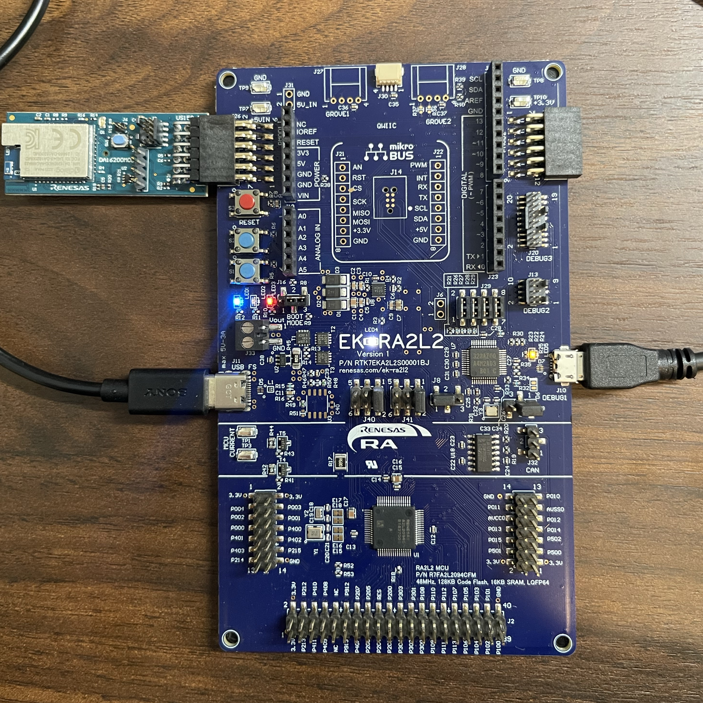
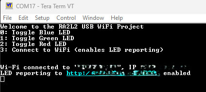
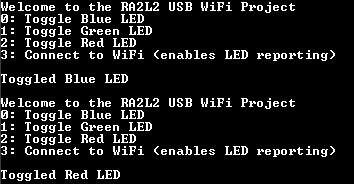
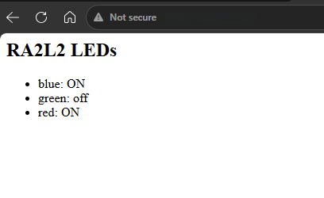

# RA2L2 USB WiFi Application

This FreeRTOS application combines USB terminal control with Wi-Fi status reporting on the EK-RA2L2. A PC terminal controls the board's three LEDs through USBFS CDC, while a DA16200 module reports their states to a Python-hosted webpage through HTTP GET requests. The project uses FSP 6.6.0, with USB and Wi-Fi functionality optimized to fit within the RA2L2's 16 KB SRAM.

## Application structure

### USB Thread

[`usb_thread_entry.c`](src/usb_thread_entry.c) manages the PC terminal interface using a 1,024-byte stack. At startup, it opens USBFS as a CDC virtual COM port and initializes the low-power driver. USB descriptors are defined in [`r_usb_pcdc_descriptor.c`](src/r_usb_pcdc_descriptor.c). The thread then waits on `g_usb_queue`, where `usb_callback()` posts events for configuration, data transfers, control requests, and connection changes.

Once the USB driver is configured, the thread starts asynchronous reads into an 8-byte buffer. Each completed read schedules another read and passes the first received character to `handle_usb_command()` when USB transmission is ready. Commands `0`-`2` select an LED, and `3` requests a Wi-Fi connection; other characters display the menu.

For a valid command, the USB Thread sends the command byte through `g_wifi_queue` and blocks on `g_led_sem`. The Wi-Fi Thread releases this semaphore when the LED has been toggled or the connection result is ready. The USB Thread then prints the appropriate confirmation, retrieving connection feedback through `wifi_app_result_get()`.

All application USB writes pass through `print_to_console()`. A transmit-ready flag is cleared when a write begins and restored by `USB_STATUS_WRITE_COMPLETE`, preventing overlapping terminal messages. Commands received while transmission is busy are ignored, so terminal input should be entered one selection at a time.

The thread also services CDC line-coding and control-line requests. These virtual COM settings are separate from the DA16200 UART configuration. On USB suspend, it enters Software Standby through `r_lpm`, with USBFS configured as the wake source. The USB resume event restores the application's attachment state.

### Wi-Fi Thread

[`wifi_thread_entry.c`](src/wifi_thread_entry.c) uses a 1,280-byte stack and blocks on `g_wifi_queue` until a command arrives. It maintains the blue, green, and red LED states and performs GPIO updates and network operations sequentially.

- **LED command:** `led_toggle()` updates the selected LED's stored state and GPIO output. The thread immediately releases `g_led_sem`, allowing USB confirmation before attempting an HTTP update containing all three LED states. Local LED control therefore works before Wi-Fi is connected, and confirmation indicates that the physical LED change has occurred.
- **Connect command:** `wifi_connect()` initializes the DA16200 if needed, joins the configured access point if disconnected, obtains its network configuration through DHCP, and opens the on-chip HTTP client. It then attempts an initial LED report and prepares feedback containing the connection result, assigned IP address, and reporting outcome before releasing the semaphore.

[`wifi_config.c`](src/wifi_config.c) implements the connection and reporting helpers. FSP's `r_sci_uart` and `rm_at_transport_da16xxx_uart` carry AT commands over SCI0 at **115200 baud, 8-N-1**, using **P101 TX** and **P100 RX**. `rm_wifi_da16xxx` manages Wi-Fi connectivity, while `rm_http_onchip_da16xxx` accesses the DA16200's HTTP client. Network protocol processing runs on the module.

Once the HTTP client is initialized, `wifi_send_led_status()` builds a URL containing the current LED states and submits it through `RM_HTTP_DA16XXX_Send()`:

```text
http://<server-ip>:8000/update?blue=1&green=0&red=1
```

Reports occur during connection setup and after subsequent LED toggles. Each request contains a complete state snapshot for the Python server. HTTP operations run within the Wi-Fi thread, so a pending transaction can delay the next queued command.

### Shared components and SRAM

[`usb_wifi_interface.h`](src/usb_wifi_interface.h) defines command characters and terminal messages. Generated FSP code creates the application threads and these static synchronization objects:

| Object | Capacity | Role |
|---|---|---|
| `g_usb_queue` | 16 event pointers | USB callback to USB thread |
| `g_wifi_queue` | 8 command bytes | USB thread to Wi-Fi thread |
| `g_led_sem` | Binary semaphore | Command acknowledgement |

The Wi-Fi command TX/RX buffers and UART transport RX buffer are each 512 bytes. HTTP uses a 128-byte request buffer and a 256-byte response buffer, reused for connection feedback. USB menu strings remain in flash. Application task stacks and RTOS objects are static; the FreeRTOS heap is 4,600 bytes. USB DMA/DTC and FreeRTOS software timers are disabled.

The reference Debug map allocates 15,968 bytes before final linker alignment, approximately 97.5% of SRAM. This includes the reserved heap and describes the linked layout, not measured runtime heap or stack usage.

## Project setup and configuration

This project is a Renesas RA CMake project generated by the RA Smart Configurator (RASC). The FSP configuration is stored in `configuration.xml`; RASC generates `ra/`, `ra_gen/`, and `ra_cfg/` from it.

### Requirements and hardware

Use an EK-RA2L2, a US159-DA16200MEVZ module with compatible AT-command firmware, and a PC with Python 3 and Tera Term or another serial terminal. Building requires FSP/RASC 6.6.0, the Arm LLVM toolchain, CMake, and the build tool selected by your kit or preset, such as Ninja. For VS Code, install the Renesas development/debug extensions and CMake Tools.

1. Connect the DA16200 to **Pmod 1, J26**, matching the orientation shown below. This connector provides the project's SCI0 TX/RX signals and module reset connection.
2. Connect **J10, DEBUG1** to the PC for programming/debugging, and **J11, USB FS** for the application terminal. Use data-capable cables.
3. Keep the board in normal Single-Chip boot mode (**J16 pins 2–3**). See the [EK-RA2L2 user's manual](https://www.renesas.com/en/document/mat/ek-ra2l2-v1-users-manual) for board jumper details.




### Wi-Fi and server configuration

Edit [`src/wifi_config.h`](src/wifi_config.h) before building:

| Setting | Value to supply |
|---|---|
| `WIFI_SSID` | Access-point name |
| `WIFI_PASSWORD` | Access-point password |
| `WIFI_SECURITY` | Matching security type |
| `STATUS_SERVER` | PC's reachable address |

Determine your PC's IPv4 address and update `STATUS_SERVER` with this address followed by the port matching the Python server (`led_server.py` uses :8000). From the repository root, start [`server/led_server.py`](server/led_server.py) in a separate terminal:

```powershell
cd server
python led_server.py
```

Keep this terminal active, copy the updated address from `STATUS_SERVER`, and paste it into your browser URL. Verify that your PC firewall allows inbound connections to its TCP port.

### Building via CLI

Check the `CMakePresets.json` file for preset configuration. Define the related environment variables or create your own `CMakeUserPresets.json` file for your system. Required variables:

- `RASC_EXE_PATH`: path of the FSP Smart Configurator executable
- `ARM_LLVM_TOOLCHAIN_PATH`: path of the toolchain's binary directory
- If Ninja is not in the `PATH`, `CMAKE_MAKE_PROGRAM` should point to the Ninja executable file path

The supplied presets use schema version 10, requiring [CMake 3.31 or later](https://cmake.org/cmake/help/v3.31/manual/cmake-presets.7.html). Choose Debug or Release.

Configure with `cmake --preset <config preset name>`:

```sh
cmake --preset DebugCI
cmake --preset ReleaseCI
```

Build with `cmake --build --preset <build preset name>`:

```sh
cmake --build --preset DebugCI
cmake --build --preset ReleaseCI
```

Build output is written to `build/Debug` or `build/Release`. Program the generated ELF through the Renesas/J-Link debugger using J10, then resume execution.

### Configuring via Visual Studio Code presets

- Define the environment variables needed in `CMakePresets.json`, or, if the Renesas Platform Extension is installed, let it create `CMakeUserPresets.json` for your environment.
- Select a configure preset and click **Build** in the VS Code status bar.

### Configuring via Visual Studio Code kits

- Set `ARM_LLVM_TOOLCHAIN_PATH` as an environment variable before starting VS Code, or set it in `.vscode/cmake-kits.json`.
- Set `RASC_EXE_PATH` to the path of the FSP Smart Configurator executable.
- Select one of the **ARM LLVM** kits (`ARM LLVM - Ninja`, `ARM LLVM - MinGW Makefiles`, or `ARM LLVM - Unix Makefiles`) in the VS Code status bar.
- Avoid spaces in the toolchain and project paths, as CMake and the other build tools might interpret them as delimiters.

Example (Windows Command Prompt):

```bat
set ARM_LLVM_TOOLCHAIN_PATH=/your/toolchain/bin/path
set RASC_EXE_PATH=/your/smart/configurator/path
cd /your/project/location
code .
```

Alternatively, open the workspace file with `code RA2L2_USB_WiFi.code-workspace`. Then click **Build** in the VS Code status bar.

### Switching between CMake kits and presets in VS Code

- Set `"cmake.useCMakePresets"` to `"never"` to enable kits.
- Set `"cmake.useCMakePresets"` to `"always"` to enable presets.
- Set `"cmake.useCMakePresets"` to `"auto"` to enable presets when preset JSON files exist.

This project's `.vscode/settings.json` sets `"cmake.useCMakePresets"` to `"never"`, so VS Code uses kits by default.

## Terminal use and demonstration

### Open the console

With the firmware running, open Tera Term and select the COM port associated with **J11 USB FS**. Find its number under **Ports (COM & LPT)** in Windows Device Manager; the `COM17` shown in the screenshot is only an example. The terminal's virtual serial baud setting does not change the DA16200's fixed UART baud rate.

Press any key other than `0`-`3` (Space for example) to display the menu. Commands are single keypresses; Enter is unnecessary. Send one command at a time and wait for feedback, since only the first byte of each received buffer is interpreted.

```text
Welcome to the RA2L2 USB WiFi Project
0: Toggle Blue LED
1: Toggle Green LED
2: Toggle Red LED
3: Connect to WiFi (enables LED reporting)
```

| Key | Action | GPIO |
|---|---|---|
| `0` | Toggle blue LED | P204 |
| `1` | Toggle green LED | P304 |
| `2` | Toggle red LED | P303 |
| `3` | Connect and enable HTTP reporting | N/A |

### Connect and verify updates

Start the Python server, then press `3`. A successful connection and initial report produce output in this format:

```text
Wi-Fi connected to "<SSID>", IP <module-ip>
LED reporting to http://<server-ip>:8000 enabled
```

The first IP address belongs to the DA16200; the reporting URL points to the PC.



Press `0`, `1`, or `2` to toggle blue, green, or red. After each command, the terminal redisplays the menu followed by the corresponding `Toggled Blue LED`, `Toggled Green LED`, or `Toggled Red LED` message, while the module reports all three states.



Starting with all LEDs off, pressing `0` and then `2` leaves blue and red on and green off. Open `http://<server-ip>:8000/` in a browser to verify these states. The page automatically refreshes every 2 seconds.



If the console remains blank, confirm the firmware is running, J11 is connected, and the correct COM port is open, then press any key (other than `0`-`3`). If Wi-Fi connects but the server does not answer, check the PC address, port, server process, firewall, and network isolation settings.

